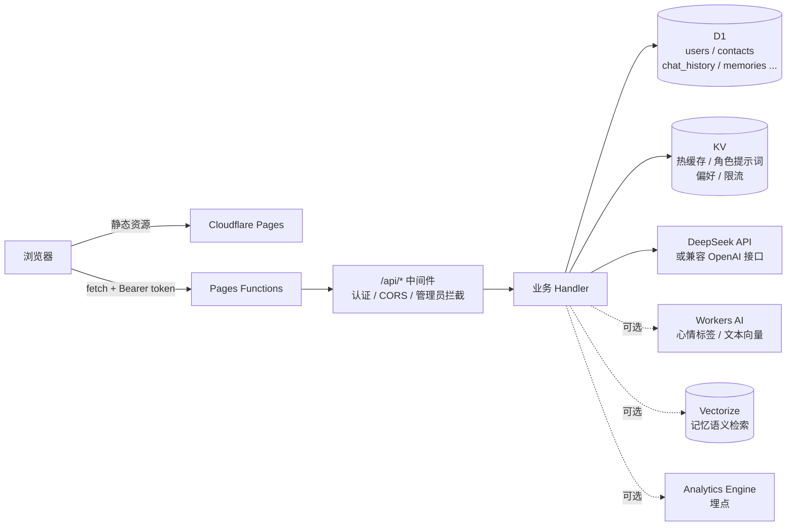

<div align="center">

# 💬 PChat

**多用户 AI 角色扮演聊天室 —— 基于 Cloudflare Pages + Functions 的全栈无服务器应用**

[](https://www.gnu.org/licenses/gpl-3.0)
[](https://pages.cloudflare.com/)
[](CHANGELOG.md)

</div>

> 一句话：把「和 AI 角色长期聊天」做成一个可以开给朋友用的网站 —— 聊天、记忆、情绪、外观与管理员后台都在里面，业务数据留在自己的 Cloudflare 账号里。

---

## 📖 简介

**PChat** 是一个面向 AI 角色扮演（Roleplay）的 Web 应用。它不是简单的聊天框，而是提供了类似微信的会话界面、长期记忆与情绪演变、时光机回放、分享卡片，以及一整套可实时预览的外观定制。

技术上它没有构建步骤、没有传统服务器：

- **前端**是原生 HTML / CSS / JavaScript，直接由 Cloudflare Pages 托管；
- **后端**是 Cloudflare Pages Functions（`functions/` 目录即路由），负责认证、AI 调用、数据读写；
- **数据**落在 Cloudflare D1（SQLite）与 KV 中；
- **AI**通过 DeepSeek API 或任何兼容 OpenAI 格式的接口调用；
- 可选绑定 Workers AI / Vectorize / Analytics Engine，分别用于心情标签、语义记忆检索与埋点。

---

## ✨ 功能特性

### 💬 聊天与角色扮演
- **流式回复（SSE）**：AI 边生成边显示；支持「继续」「重新生成」「带自定义指令重新生成」。
- **角色设定分层**：联系人与 AI 参数存 D1；角色提示词、开场白、回复格式、场景、外貌存 KV。
- **按角色独立的 AI 参数**：temperature、top_p、max_tokens、频率惩罚、存在惩罚、记忆窗口、上下文窗口。
- **导演词**：临时提示词，只对本次对话生效，不写入历史。
- **安全词**：消息命中安全词时立即中止角色扮演，改用冷静中性的语气回应，并跳过记忆/承诺注入。
- **引用回复、编辑消息（保留编辑历史）、消息版本切换、删除单条消息**。
- **Markdown 渲染 + DOMPurify 消毒**（`marked` / `purify` 打包在仓库内，不依赖外部 CDN）。
- **三种消息接收模式**：SSE、短轮询、长轮询（用于普通联系人消息，可在设置中切换）。

### 🧠 长期记忆与情绪
- **自动记忆提炼**：每攒够 `memory_window` 条对话，就用大模型提炼一条长期记忆，附带情绪标签与强度。
- **记忆注入与自清理**：记忆会拼进系统提示词；AI 可在回复末尾用 `【删除记忆：编号】` 删除本次注入过的记忆（有白名单校验，不会误删手工记忆）。
- **语义检索（可选）**：绑定 `AI` + `VECTORIZE` 时按当前消息检索最相关的记忆；未绑定时自动回退到「最近 N 条」。
- **心情与亲密度**：每轮对话后由 Workers AI 打一个心情标签（10 种白名单），亲密度 +1（上限 100），映射为「刚认识 / 熟悉 / 亲近 / 亲密」注入提示词。
- **承诺追踪**：自动提取 AI 在对话中答应过的事，未完成的承诺会持续注入提示词，也可手动增删改。
- **会话洞察**：相识天数、累计消息、连续聊天天数、最近 14 天柱状图、活跃时段、情绪分布。
- **年度热力图与本机用量**：最近 53 周的聊天活跃度、本地缓存占用。

### 🎨 外观与玩法（`/studio` 外观与玩法中心）
- **主题**：明亮 / 黑暗 / 跟随系统；6 套强调色（石墨、樱粉、海蓝、森绿、暮橙、紫藤），按钮与气泡使用两套色阶。
- **聊天背景**：6 套内置纹理（纸纹、点阵、网格、晨雾、夜雨、晚霞）+ 自定义图片（压缩后存 IndexedDB，可调模糊与遮罩）。
- **氛围粒子**：樱花、星尘、细雨、飘雪四种 Canvas 特效；双击聊天区空白处会从鼠标位置撒花。
- **场景预设**：雨夜书房、樱花午后、深夜电台、极简纸墨四套一键切换，也能把当前外观存为预设（最多 12 套）。
- **排版**：气泡样式（微信式 / 全圆角 / 直角）、内容行宽、头像大小、时间标签、字号 4 档、疏密 3 档。
- **动画与性能**：4 种入场动画 + 一键性能模式（关闭所有动画与粒子）。
- **语音朗读**：Web Speech API，双击 AI 气泡朗读，可调速、可自动朗读，`Esc` 停止。
- **命令面板**：`Ctrl/Cmd + Shift + P` 搜索并执行常用功能。
- **本地指令**：`/me`、`/roll`、`/coin`、`/pick`、`/time`、`/help`，全部在浏览器本地执行，不消耗额度。
- **时光机**：挑一天，按顺序重播当天的对话，支持暂停、1x/2x/3x 倍速。
- **分享卡片**：右键消息 →「生成分享卡片」，用 Canvas 在本地画成一张 PNG。

### 🛡️ 多用户与安全
- **环境变量管理员**：配置 `ADMIN_USERNAME` / `ADMIN_PASSWORD`，首次登录自动在 `users` 表建管理员账号（数据库里只存占位哈希，真实密码只在环境变量中）。
- **密码存储**：PBKDF2-SHA256、10 万次迭代、16 字节随机盐；旧版无盐 SHA-256 在登录成功后自动升级。
- **会话**：`sessions` 表保存 7 天有效的 token，同一用户只保留一个有效会话；账号被停用/封禁后立即失效。
- **登录审计与限流**：成功 / 失败 / 拦截写入 `login_logs`；同一 IP 15 分钟内累计 10 次失败后拒绝尝试（登录成功会清零计数）。
- **人机验证（可选）**：配置 `TURNSTILE_SECRET` 后，登录与注册校验 Cloudflare Turnstile。
- **用户自备 Key**：AES-GCM 256 加密后存入 `user_secrets`，只在服务端解密，保存后不回显。
- **注册管控**：默认关闭注册，可要求邀请码；注册接口永远只产生 `user` 角色。
- **数据隔离**：聊天、记忆、承诺、收藏、回应、用量、审计日志的读写全部带 `user_id` 条件。
- **接口防护**：CORS 白名单 fail-closed（未配置时仅同源）、CSP 等安全响应头、`/api/admin/*` 强制管理员、错误响应不携带堆栈。
- **输入限制**：所有长度与 AI 参数在 `_lib.LIMITS` / `clamp` 中集中限制，SQL 全部使用 `?` 占位符。

### 👑 管理后台
- **系统管理**（`/admin/admin.html`，仅管理员）：系统初始化状态、随机主密钥生成、运行级功能开关、邀请码管理、用户管理（搜索 / 封禁 / 解封）、Token 用量、操作日志、登录日志与保留天数。
- **角色管理**（`/admin/roles.html`，登录用户均可使用）：新建 / 编辑自己的 AI 角色，配置提示词、开场白、格式、场景、外貌与全部 AI 参数，查看心情与亲密度，归档、恢复或彻底删除。
- **数据统计**（`/admin/stats.html`）：用 ECharts 6 展示每日消息量、情绪趋势与分布、各角色消息量、活跃时段。

---

## 🧱 技术栈

| 层 | 选型 | 说明 |
| :--- | :--- | :--- |
| 前端 | 原生 HTML / CSS / JavaScript | 无构建步骤、无框架，Pages 直接托管 |
| 后端 | Cloudflare Pages Functions | `functions/` 目录即路由，ES Module |
| 数据库 | Cloudflare D1（SQLite） | 用户、联系人、聊天、记忆、日志、配置 |
| 缓存 | Cloudflare KV | 聊天热缓存、角色提示词、偏好、限流计数 |
| AI | DeepSeek API（兼容 OpenAI） | 默认模型 `deepseek-flash`，可自定义 |
| 可选 | Workers AI / Vectorize / Analytics Engine | 心情标签、语义记忆、埋点 |
| 图表 | ECharts 6（jsdelivr CDN） | 管理端与统计页 |
| 渲染 | marked + DOMPurify | 已打包在 `js/`，不依赖外部 CDN |

### 架构



### 一次 AI 回复的完整链路

1. `POST /api/ai/stream` → 中间件校验 session，并从 `users` 取出 `role` / `status`。
2. 并行加载联系人参数、最近历史（KV 热缓存优先，D1 回源）、角色提示词、元数据、用户偏好、安全词。
3. 选择 API Key：用户自备 Key（可解密）→ 系统 Key（`USE_SYSTEM_API_KEY` + `system_api_key_enabled` + `DEEPSEEK_API_KEY`）。
4. `buildSystemPrompt()` 按固定顺序拼接：角色设定 → 回复格式 → 场景 → 外貌 → 关于用户 → 心情 → 关系阶段 → 长期记忆 → 承诺 → 导演词说明 → 当前时间 → 重新生成要求。
5. 调用上游 `/chat/completions`（`stream: true`），边转发 SSE 边累积全文；客户端中断也会继续读完并落库。
6. 写入 `chat_history` + 更新 KV 热缓存，触发记忆提炼、心情/亲密度更新，使用系统 Key 时累计 `user_usage`。

---

## 📁 目录结构

```text
PChat/
├─ index.html                  # 聊天主页面（登录 / 联系人 / 聊天 / 设置弹窗）
├─ studio.html                 # 外观与玩法中心（/studio）
├─ css/
│  ├─ theme.css                # 设计令牌：颜色、圆角、阴影
│  ├─ base.css                 # 基础底座与布局
│  ├─ components.css           # 按钮、弹窗、表单、Toast、开关
│  ├─ chat.css                 # 聊天布局、气泡、命令面板、时光机、分享卡片
│  └─ studio.css               # 外观中心专用
├─ js/
│  ├─ app.js                   # 登录、联系人、消息渲染、流式对话、设置、草稿
│  ├─ features.js              # 收藏、回应、搜索、承诺、编辑历史、右键菜单
│  ├─ enhance.js               # 配色、粒子、命令面板、排版、朗读、置顶、本地指令
│  ├─ enhance-cinema.js        # 时光机、分享卡片
│  ├─ studio.js                # 外观中心界面逻辑
│  ├─ studio-data.js           # 备份 / 导入 / 本机用量 / 热力图
│  ├─ export.js                # 对话导出
│  ├─ modal.js / storage.js / theme.js / param-info.js
│  ├─ turnstile.js             # 人机验证前端封装
│  ├─ version.js               # 版本号唯一来源（window.APP_VERSION）
│  └─ marked.min.js / purify.min.js
├─ admin/
│  ├─ roles.html / roles.js    # 角色管理（每个用户管理自己的角色）
│  ├─ admin.html / admin.js    # 系统管理（仅管理员）
│  ├─ stats.html / stats.js    # 数据统计
│  └─ AGM.css / admin.css / roles.css / stats.css
├─ functions/
│  ├─ _middleware.js           # 全局安全响应头（CSP 等）
│  ├─ api/_middleware.js       # /api/* 认证 + CORS + 管理员拦截
│  ├─ _lib.js                  # 共享库：鉴权、加解密、缓存、提示词、记忆、审计
│  └─ api/                     # 按模块拆分的接口（auth / contacts / ai / admin ...）
├─ images/                     # 静态图片
├─ CHANGELOG.md                # 更新日志
├─ LICENSE                     # GPL-3.0
└─ readme.md
```

> 说明：仓库中 `css/enhance.css` 为旧版样式，当前页面未引用；数据库建表脚本、`wrangler.toml`、`package.json` 未包含在本仓库中，建表 SQL 见文末附录。

---

## 🚀 快速开始

### 前置条件

1. 一个 [Cloudflare](https://dash.cloudflare.com/) 账号；
2. 一个 [DeepSeek API Key](https://platform.deepseek.com/)（或兼容 OpenAI 格式的服务）；
3. Node.js 20+（只用于运行 `npx wrangler`，项目本身不需要构建）；
4. Fork / 克隆本仓库。

### 第一步：创建 D1 与 KV

在本地登录 Wrangler：

```bash
npx wrangler login
```

创建资源（也可以在 Cloudflare 控制台手动创建）：

```bash
# D1 数据库
npx wrangler d1 create pchat-db

# 两个 KV 命名空间
npx wrangler kv namespace create CHAT_HISTORY
npx wrangler kv namespace create PROMPTS_KV
```

记下命令输出的 `database_id` 与两个 KV 的 `id`。

### 第二步：初始化数据库

把文末[附录：D1 建表脚本](#附录d1-建表脚本)保存为 `schema.sql`，然后执行：

```bash
npx wrangler d1 execute pchat-db --remote --file=./schema.sql
```

### 第三步：在 Pages 中绑定资源

在 Cloudflare Pages 创建项目并连接仓库：

- **Build command**：留空；
- **Build output directory**：`/`（项目根目录，也可填 `.`；静态文件与 `functions/` 都在这里）。

然后在 **Settings → Functions → Bindings** 添加：

| 类型 | 变量名 | 必填 | 说明 |
| :--- | :--- | :--- | :--- |
| D1 database | `DB` | ✅ | 主数据库 |
| KV namespace | `CHAT_HISTORY` | ✅ | 聊天热缓存（`chat_cache_v2_*`） |
| KV namespace | `PROMPTS_KV` | ✅ | 角色提示词、元数据、偏好、限流计数 |
| KV namespace | `APP_SETTINGS_KV` | ❌ | 设置缓存专用；未绑定时复用 `PROMPTS_KV` |
| Workers AI | `AI` | ❌ | 心情标签、文本向量 |
| Vectorize | `VECTORIZE` | ❌ | 记忆语义检索 |
| Analytics Engine | `AE` | ❌ | 埋点（`writeDataPoint`） |

### 第四步：配置环境变量

在 **Settings → Environment variables** 添加（Production 与 Preview 都要）：

| 变量名 | 必填 | 说明 |
| :--- | :--- | :--- |
| `ADMIN_USERNAME` | ✅ | 超级管理员登录名；首次登录自动在 `users` 表建号 |
| `ADMIN_PASSWORD` | ✅ | 超级管理员密码；恒定时间比较，建议 16 位以上随机串 |
| `SECRET_MASTER_KEY` | ✅ | 加密用户 API Key 的主密钥（任意高熵字符串，推荐 `openssl rand -base64 32`） |
| `DEEPSEEK_API_KEY` | ✅ | 系统默认 AI Key；还需 `USE_SYSTEM_API_KEY` 与功能开关同时允许 |
| `ALLOWED_ORIGINS` | ❌ | 跨域白名单，逗号 / 空格分隔，必须是完整 Origin；不配置 = 仅同源 |
| `TURNSTILE_SECRET` | ❌ | 配置后登录 / 注册强制校验 Turnstile |
| `TURNSTILE_SITE_KEY` | ❌ | 前端站点密钥（需手动写入 `index.html` 的 meta，见「已知限制」） |
| `USE_SYSTEM_API_KEY` | ❌ | 默认开启；设为 `0` / `false` / `off` 强制用户自备 Key |
| `SYSTEM_KEY_RATE_LIMIT` | ❌ | 使用系统 Key 时每用户每分钟上限，默认 10，`0` = 不限 |
| `AI_GATEWAY_URL` | ❌ | Cloudflare AI Gateway 基址，作为默认 AI 接口地址 |
| `CF_AIG_TOKEN` | ❌ | AI Gateway 令牌，只在请求发往该 Gateway 时携带 |
| `AI_MOOD_MODEL` | ❌ | 心情模型，默认 `@cf/meta/llama-3.2-3b-instruct` |
| `ADMIN_LOG_MAX_COUNT` | ❌ | 操作日志保留条数，默认 2000 |
| `LOGIN_LOG_MAX_COUNT` | ❌ | 登录日志保留条数，默认 5000 |

> ⚠️ `SECRET_MASTER_KEY` 一旦更换，用户已加密保存的 API Key 将无法解密，需要用户重新保存。
>
> 💡 代码中的默认模型是 `deepseek-flash`。如果你的上游服务没有这个模型名，请在聊天页「设置 → 模型与接口」改成 `deepseek-chat`、`deepseek-reasoner` 等实际模型。

### 第五步：部署并首次登录

重新部署 Pages 项目，打开站点：

1. 用 `ADMIN_USERNAME` / `ADMIN_PASSWORD` 登录，系统会自动创建管理员账号；
2. 进入「角色管理」新建一个 AI 角色（填写名称、提示词、开场白等）；
3. 回到聊天页开始对话。

管理员入口：聊天页右上角的盾牌图标（`/admin/admin.html`）。

### 第六步：按需开放注册

默认配置：**注册关闭**（`allow_register = '0'`）、**注册需邀请码**（`invite_required = '1'`）。

开放注册需要两步：

**1）打开注册开关**（直接写 D1；管理页的功能开关保存存在已知问题，见「已知限制」）：

```bash
npx wrangler d1 execute pchat-db --remote --command "INSERT INTO app_settings (key, value, updated_at) VALUES ('allow_register','1',datetime('now')) ON CONFLICT(key) DO UPDATE SET value='1', updated_at=datetime('now');"
```

**2）生成邀请码**：进入「系统管理 → 邀请码管理」，设置有效天数后生成，把 `XXXX-XXXX-XXXX` 发给对方。

---

## 💻 本地开发

### 1. 创建 `wrangler.toml`（本地与部署共用）

```toml
name = "pchat"
compatibility_date = "2024-11-01"
pages_build_output_dir = "."

[[d1_databases]]
binding = "DB"
database_name = "pchat-db"
database_id = "<D1_DATABASE_ID>"

[[kv_namespaces]]
binding = "CHAT_HISTORY"
id = "<KV_ID_CHAT_HISTORY>"

[[kv_namespaces]]
binding = "PROMPTS_KV"
id = "<KV_ID_PROMPTS_KV>"

# ---- 以下均为可选 ----
# [[kv_namespaces]]
# binding = "APP_SETTINGS_KV"
# id = "<KV_ID_APP_SETTINGS>"

# [[vectorize]]
# binding = "VECTORIZE"
# index_name = "pchat-memories"

# [ai]
# binding = "AI"

# [[analytics_engine_datasets]]
# binding = "AE"
# dataset = "pchat_events"
```

### 2. 创建 `.dev.vars`

```ini
ADMIN_USERNAME=admin
ADMIN_PASSWORD=change-me-to-a-long-random-string
SECRET_MASTER_KEY=please-generate-a-random-32-byte-key
DEEPSEEK_API_KEY=sk-xxxxxxxxxxxxxxxx
```

> `.dev.vars` 含密钥，务必加入 `.gitignore`，不要提交。

### 3. 初始化本地数据库并启动

```bash
npx wrangler d1 execute pchat-db --local --file=./schema.sql

npx wrangler pages dev . --compatibility-date=2024-11-01
```

访问 `http://localhost:8788`（端口以 Wrangler 输出为准）。

> 可选资源：使用语义记忆时先创建 512 维向量索引：
> `npx wrangler vectorize create pchat-memories --dimensions=512 --metric=cosine`。
> 未绑定 `AI` / `VECTORIZE` 时，心情标签与语义检索会自动降级，不影响主流程。

---

## 🕹️ 使用指南

### 聊天页（`/`）

- **联系人**：左侧列表；桌面端可收起，手机端为抽屉。没有 AI 角色时先在「角色管理」创建。
- **顶部按钮**：搜索、时光机、收藏、导出、AI 承诺、AI 设置、清空记录；手机端收进 `⋮`。
- **消息操作**：右键 / 长按消息 → 复制、引用回复、收藏、表情回应、编辑、查看编辑历史、删除、生成分享卡片、朗读。
- **输入区**：`Enter` 发送、`Shift + Enter` 换行；🎬 按钮开启导演词；回复时输入框上方显示引用条。
- **AI 设置**：点击聊天中的 AI 头像或顶部滑块图标，调整全局模型与当前角色的参数、头像。
- **设置**：个人资料、明暗主题、消息接收模式、全局模型 / API 地址、我的 API Key、我的登录日志、关于我自己、安全词、版本与更新日志。

### 外观与玩法中心（`/studio`）

包含实时预览、主题与配色、场景预设、聊天背景、氛围特效、阅读舒适度、排版、动画与性能、语音朗读、联系人置顶、数据与洞察、玩法与快捷键、恢复默认外观。所有偏好保存在浏览器 `localStorage`（前缀 `enh_`），背景图存 IndexedDB。

### 管理页面

| 页面 | 地址 | 权限 | 内容 |
| :--- | :--- | :--- | :--- |
| 角色管理 | `/admin/roles.html` | 登录用户 | 管理自己的 AI 角色、参数、归档区 |
| 系统管理 | `/admin/admin.html` | 管理员 | 初始化状态、功能开关、邀请码、用户、用量、日志 |
| 数据统计 | `/admin/stats.html` | 登录用户 | 消息量、情绪、活跃时段等图表 |

### 快捷键与本地指令

| 快捷键 | 作用 |
| :--- | :--- |
| `Ctrl/Cmd + Shift + P` | 打开命令面板 |
| `Ctrl/Cmd + K` | 搜索聊天记录 |
| `Ctrl/Cmd + Shift + L` | 朗读最后一条回复 |
| `Enter` / `Shift + Enter` | 发送 / 换行 |
| 输入框为空时 `↑` | 编辑我发的上一条消息 |
| `Esc` | 关闭弹窗 / 停止朗读 / 取消引用 |
| 双击 AI 气泡 | 朗读该条消息 |
| 双击聊天区空白 | 撒花 |

| 指令 | 作用 |
| :--- | :--- |
| `/me 伸了个懒腰` | 以斜体动作气泡显示（同时照常发给角色） |
| `/roll 2d6+1` | 掷骰子 |
| `/coin` | 抛硬币 |
| `/pick 火锅 烧烤 拉面` | 随机选择 |
| `/time` | 查看当前时间 |
| `/help` | 查看指令帮助 |

### 数据导出与导入

- **导出单个对话**：聊天页顶部导出按钮，支持 `json` / `md` / `txt`，可指定时间段，文件名支持中文。
- **完整备份**：外观中心 →「数据与洞察」→ 导出全部角色（JSON）。
- **导入**：外观中心 → 选择本项目导出的 JSON →「先预览」确认条数与重复数 → 合并 / 覆盖 / 新建角色。
- 导入会清理该角色的上下文缓存，并把记忆提取进度推进到导入后的最大 id，避免下一次聊天把历史当成积压重复提炼。

---

## 🔌 API 一览

所有 `/api/*` 接口除下方标注「公开」外都需要 `Authorization: Bearer <token>`；`/api/admin/*` 额外要求 `role = admin`。

| 模块 | 方法与路径 | 说明 |
| :--- | :--- | :--- |
| 认证 | `POST /api/auth/login` | 公开；环境变量管理员或数据库用户登录 |
| 认证 | `POST /api/auth/register` | 公开；受 `allow_register` / `invite_required` 控制 |
| 认证 | `POST /api/auth/logout` | 公开；删除当前 session |
| 认证 | `PUT /api/auth/profile` | 修改用户名 / 密码 / 头像（需当前密码） |
| 联系人 | `GET/POST /api/contacts` | 列表 / 新建联系人及角色设定 |
| 联系人 | `GET/PUT/DELETE /api/contacts/:id` | 详情 / 更新 / 归档（DELETE 仅归档） |
| 联系人 | `PUT /api/contacts/:id/config` | 更新 AI 参数 |
| 联系人 | `PUT/DELETE /api/contacts/:id/archive` | 归档 / `?restore=1` 恢复 / `?purge=1` 彻底删除 |
| 角色 | `GET/PUT /api/role/:id/prompt` | 读写角色提示词（KV） |
| 角色 | `GET/PUT /api/role/:id/meta` | 读写角色元数据（KV） |
| AI | `POST /api/ai/stream` | 流式对话（SSE），支持 continue / regenerate / 导演词 |
| AI | `GET/DELETE /api/ai/history` | 拉取历史 / 按 id 批量删除 |
| AI | `GET/PUT /api/ai/message` | 查询编辑历史 / 编辑消息 |
| AI | `GET /api/ai/search` | 关键词搜索聊天记录 |
| AI | `GET /api/ai/replay` | 时光机：可用日期 / 某天消息 |
| AI | `GET /api/ai/export` | 导出单个对话（json/md/txt） |
| AI | `GET /api/ai/export-all` | 完整备份（全部角色） |
| AI | `POST /api/ai/import` | 导入对话（dry-run / merge / replace） |
| 消息 | `GET/POST /api/messages` | 普通联系人消息列表 / 发送 |
| 消息 | `DELETE /api/messages/:id` | 删除单条普通消息 |
| 消息 | `GET /api/messages/stream` | SSE 推送新消息（`?token=` 传令牌） |
| 消息 | `GET /api/messages/long-poll` | 长轮询新消息 |
| 记忆 | `GET/POST/DELETE /api/memory` | 列表 / 手动新增 / 清空 |
| 记忆 | `PUT/DELETE /api/memory/:id` | 修改 / 删除单条 |
| 记忆 | `POST /api/memory/extract` | 强制提炼记忆 |
| 承诺 | `GET/POST/PUT/DELETE /api/commitments` | 承诺的增删改查 |
| 收藏 | `GET/POST/DELETE /api/favorites` | 收藏列表 / 添加 / 取消 |
| 回应 | `GET/POST /api/reactions` | 回应列表 / 切换表情（5 种白名单） |
| 洞察 | `GET /api/insights` | 会话洞察与热力图 |
| 统计 | `GET /api/stats?days=7/30/90` | 统计面板数据 |
| 用户 | `GET/PUT /api/user/preference` | 关于我自己 |
| 用户 | `GET/PUT /api/user/safeword` | 安全词 |
| 用户 | `GET/PUT/DELETE /api/user/api-key` | 自备 API Key 状态 / 保存 / 删除 |
| 用户 | `GET /api/user/login-logs` | 我的登录日志 |
| 管理 | `GET/PUT /api/admin/settings` | 功能开关读写 |
| 管理 | `GET /api/admin/system` | 系统初始化状态（只返回布尔值） |
| 管理 | `GET/POST /api/admin/invites` | 邀请码列表 / 生成 |
| 管理 | `GET /api/admin/users` | 用户列表（含今日 / 累计 token） |
| 管理 | `PUT /api/admin/users/:id` | 修改用户状态（封禁 / 解封） |
| 管理 | `GET /api/admin/usage` | Token 用量统计 |
| 管理 | `GET /api/admin/logs/admin` | 管理员操作日志 |
| 管理 | `GET/PUT /api/admin/logs/login` | 登录日志 / 保留天数 |

---

## 🗄️ 数据模型

### D1 表

| 表 | 用途 |
| :--- | :--- |
| `users` | 账号：用户名、密码哈希、角色、状态、头像 |
| `sessions` | 登录会话：token、用户、过期时间 |
| `contacts` | 联系人 / AI 角色档案与全部 AI 参数、心情、亲密度、归档标记 |
| `chat_history` | AI 对话消息（`role`、`kind`、`reply_to`、`created_at`） |
| `messages` | 普通联系人消息（非 AI 通道，SSE / 轮询使用） |
| `message_edits` | 消息编辑历史 |
| `memories` | 长期记忆（内容、来源区间、情绪、情绪强度） |
| `commitments` | AI 承诺 / 待办 |
| `favorites` | 消息收藏 |
| `reactions` | 消息表情回应 |
| `invite_codes` | 邀请码（一码一人，可设过期时间） |
| `login_logs` | 登录审计（成功 / 失败 / 拦截） |
| `admin_logs` | 管理员操作审计 |
| `app_settings` | 运行级配置（KV 缓存 60 秒） |
| `user_usage` | 每用户每日 token 用量 |
| `user_secrets` | 加密后的用户 API Key（AES-GCM） |

### KV 键

| 键 | 内容 | 说明 |
| :--- | :--- | :--- |
| `chat_cache_v2_<userId>_<contactId>` | 最近 100 条聊天记录 | 热缓存，TTL 7 天，读取时用 D1 计数校验完整性 |
| `mem_state_<userId>_<contactId>` | `{ lastId }` | 记忆提取进度 |
| `prompt_<contactId>` | 角色提示词 | 文本 |
| `meta_<contactId>` | 角色元数据 | JSON：名称、开场白、格式、场景、外貌 |
| `preference_<userId>` | 关于我自己 | 文本，≤1000 字 |
| `safeword_<userId>` | 安全词 | 文本，≤200 字 |
| `rl_login_<ip>` / `rl_ai_<userId>` / `rl_syskey_<userId>` | 限流计数 | 近似滑动窗口 |
| `app_settings_v1` | 配置缓存 | TTL 60 秒 |

---

## 🔒 安全设计

- **认证**：`/api/*` 中间件统一校验，session 查询 `JOIN users` 并拒绝 `status != 'active'`；SSE 通过 `?token=` 兼容 EventSource。
- **密码**：PBKDF2-SHA256（100000 次迭代、16 字节盐），格式 `pbkdf2:<salt>:<hash>`；旧哈希登录后自动升级。
- **管理员**：环境变量管理员每次登录都与 `ADMIN_PASSWORD` 做恒定时间比较，数据库里 `password_hash` 为占位值 `ENV_ADMIN_PROTECTED`，普通登录路径永远拒绝该占位账号。
- **加密**：`SECRET_MASTER_KEY` 经 SHA-256 派生 AES-GCM 256 密钥；密文格式 `v1:<iv>:<ciphertext>`，IV 12 字节；缺主密钥时加密直接失败，不会降级为明文。
- **CORS**：只允许同源与 `ALLOWED_ORIGINS` 白名单；不支持 `*`；未配置白名单时跨域一律 403。
- **CSRF / 点击劫持**：严格 Origin 校验；CSP 含 `frame-ancestors 'none'`，配合 `X-Frame-Options`、`nosniff`、`no-referrer`。
- **限流**：登录按 IP（15 分钟 10 次）、AI 对话按用户（每分钟 30 次）、系统 Key 按用户（默认每分钟 10 次）。
- **注册安全**：只产生 `user` 角色；禁止与环境变量管理员同名；邀请码用条件 `UPDATE` 原子核销，失败回滚账号。
- **越权防护**：所有业务查询带 `user_id`；管理接口双重校验；消息编辑 / 回应 / 收藏都校验消息归属。
- **Key 与地址绑定**：只有用户自备 Key 才允许自定义 `apiBase`；使用系统 Key 时忽略客户端地址，只走 `AI_GATEWAY_URL` 或直连 DeepSeek，避免把系统 Key 发给第三方。`cf-aig-authorization` 也只在请求确实发往管理员配置的 Gateway 时携带。
- **SQL 注入**：全部使用 `?` 占位符；`SET` 子句只拼接硬编码白名单字段名。
- **日志去敏**：`login_logs` 只存结果与原因，不存密码 / token；错误响应不返回堆栈。

---

## ⚠️ 已知限制（按当前代码整理）

以下是阅读代码时确认、与更新日志或界面提示不完全一致的地方，二次开发或部署前建议先了解：

1. **角色设定的多用户隔离不完整**：KV 键为 `prompt_<contact_id>` / `meta_<contact_id>`，不含 `user_id`。不同用户创建相同 `contact_id` 的角色时会共用同一份提示词与元数据。用于多人服务时建议改造键名，或在 `contact_id` 中拼接用户标识。
2. **Turnstile 站点密钥不会自动注入**：`index.html` 的 `<meta name="turnstile-site-key">` 默认为空，而 `functions/_middleware.js` 只写入安全响应头，并未实现注释里描述的注入逻辑。若只配置 `TURNSTILE_SECRET`，登录 / 注册会始终返回「缺少人机验证令牌」；请同时手动填写 meta 的 site key，或不要配置 secret。
3. **功能开关的保存与生效不完整**：管理页会提交 `turnstile_enabled`，但 `/api/admin/settings` 的可写白名单没有该键，整批保存会返回 400「不支持的配置项」；即使直接写入 `app_settings`，`turnstile_enabled` 与 `memory_extract_enabled` 在主流程中也没有被读取（Turnstile 只看 `TURNSTILE_SECRET`，自动记忆提炼不检查开关）。临时改配置可直接写 `app_settings` 表。
4. **仓库不包含部署脚手架**：`schema.sql`、`wrangler.toml`、`package.json`、迁移脚本与冒烟测试均不在本仓库中；本文附录提供了根据代码整理的建表 SQL，Wrangler 通过 `npx` 临时安装即可。
5. **更新日志与代码存在差异**：`CHANGELOG.md` 中提到的「账号级失败锁定」「Turnstile 站点密钥自动注入」等条目，在当前代码中未找到对应实现，请以代码和本文档为准。

---

## 📄 版本与更新日志

当前版本：**v0.14.4**（版本号唯一来源为 `js/version.js`）。

每次更新的功能、修复与升级说明见 [CHANGELOG.md](CHANGELOG.md)，也可以在应用内「设置 → 关于项目 → 查看更新日志」打开。

---

## 🤝 贡献

欢迎提交 Issue 与 Pull Request。改动涉及时请留意：

- 前端不引入构建步骤，新增脚本直接以 `<script>` 引入；
- 新增接口放在 `functions/api/` 对应目录，认证交给 `_middleware.js`；
- 新增设置项需同步 `_lib.DEFAULT_APP_SETTINGS`、`functions/api/admin/settings.js` 的白名单与 `admin/admin.js` 的 `SETTING_LABELS`；
- 数据库变更请同时更新建表 SQL 与升级说明；
- 不要把任何密钥、`.dev.vars`、个人数据提交进仓库。

---

## 📄 开源协议

本项目基于 [GPL-3.0 License](LICENSE) 开源。

---

## 附录：D1 建表脚本

> 以下 SQL 依据 `functions/` 中实际使用的表与字段整理，可直接保存为 `schema.sql` 执行。SQLite 为动态类型，字段类型仅用于表达意图。

```sql
-- ============================================================
-- PChat · D1 建表脚本
-- 执行：npx wrangler d1 execute pchat-db --remote --file=./schema.sql
-- ============================================================

-- 账号
CREATE TABLE IF NOT EXISTS users (
  id            INTEGER PRIMARY KEY AUTOINCREMENT,
  username      TEXT    NOT NULL UNIQUE,
  password_hash TEXT    NOT NULL,
  avatar        TEXT,
  role          TEXT    NOT NULL DEFAULT 'user',    -- user | admin
  status        TEXT    NOT NULL DEFAULT 'active',  -- active | disabled | banned
  created_at    TEXT    NOT NULL DEFAULT (datetime('now'))
);

-- 登录会话（7 天有效；同一用户只保留一个有效 token）
CREATE TABLE IF NOT EXISTS sessions (
  token      TEXT    PRIMARY KEY,
  user_id    INTEGER NOT NULL,
  expires_at TEXT    NOT NULL,
  created_at TEXT    NOT NULL DEFAULT (datetime('now'))
);
CREATE INDEX IF NOT EXISTS idx_sessions_user ON sessions(user_id);

-- 联系人 / AI 角色
CREATE TABLE IF NOT EXISTS contacts (
  id                INTEGER PRIMARY KEY AUTOINCREMENT,
  user_id           INTEGER NOT NULL,
  contact_id        TEXT    NOT NULL,
  contact_type      TEXT    NOT NULL DEFAULT 'ai',    -- ai | user
  display_name      TEXT    NOT NULL,
  avatar            TEXT,
  temperature       REAL    DEFAULT 0.7,
  top_p             REAL    DEFAULT 0.9,
  max_tokens        INTEGER DEFAULT 2048,
  frequency_penalty REAL    DEFAULT 0,
  presence_penalty  REAL    DEFAULT 0,
  memory_window     INTEGER DEFAULT 30,
  context_window    INTEGER DEFAULT 20,
  mood              TEXT,
  mood_updated_at   TEXT,
  intimacy          INTEGER NOT NULL DEFAULT 0,
  archived          INTEGER NOT NULL DEFAULT 0,
  created_at        TEXT    NOT NULL DEFAULT (datetime('now')),
  UNIQUE (user_id, contact_id)
);
CREATE INDEX IF NOT EXISTS idx_contacts_user ON contacts(user_id, archived);

-- AI 对话消息（kind='director' 为导演词，不进入历史上下文）
CREATE TABLE IF NOT EXISTS chat_history (
  id         INTEGER PRIMARY KEY AUTOINCREMENT,
  user_id    INTEGER NOT NULL,
  contact_id TEXT    NOT NULL,
  role       TEXT    NOT NULL,                    -- user | assistant
  content    TEXT    NOT NULL,
  kind       TEXT    NOT NULL DEFAULT 'normal',   -- normal | director
  reply_to   INTEGER,
  created_at TEXT    NOT NULL DEFAULT (datetime('now'))
);
CREATE INDEX IF NOT EXISTS idx_chat_user_contact ON chat_history(user_id, contact_id, id);
CREATE INDEX IF NOT EXISTS idx_chat_user_time    ON chat_history(user_id, contact_id, created_at);

-- 普通联系人消息（非 AI 通道）
CREATE TABLE IF NOT EXISTS messages (
  id           INTEGER PRIMARY KEY,               -- 由服务端写入毫秒时间戳
  user_id      INTEGER NOT NULL,
  username     TEXT    NOT NULL,
  content      TEXT    NOT NULL,
  contact_type TEXT    NOT NULL DEFAULT 'user',
  contact_id   TEXT    NOT NULL DEFAULT 'default',
  created_at   TEXT    NOT NULL DEFAULT (datetime('now'))
);
CREATE INDEX IF NOT EXISTS idx_messages_user ON messages(user_id, id);

-- 消息编辑历史
CREATE TABLE IF NOT EXISTS message_edits (
  id          INTEGER PRIMARY KEY AUTOINCREMENT,
  message_id  INTEGER NOT NULL,
  old_content TEXT,
  new_content TEXT,
  edited_at   TEXT    NOT NULL DEFAULT (datetime('now'))
);
CREATE INDEX IF NOT EXISTS idx_edits_message ON message_edits(message_id);

-- 长期记忆
CREATE TABLE IF NOT EXISTS memories (
  id            INTEGER PRIMARY KEY AUTOINCREMENT,
  user_id       INTEGER NOT NULL,
  contact_id    TEXT    NOT NULL,
  content       TEXT    NOT NULL,
  source_start  INTEGER,
  source_end    INTEGER,
  emotion       TEXT,
  emotion_score REAL,
  created_at    TEXT    NOT NULL DEFAULT (datetime('now'))
);
CREATE INDEX IF NOT EXISTS idx_memories_user ON memories(user_id, contact_id, id);

-- 承诺 / 待办
CREATE TABLE IF NOT EXISTS commitments (
  id         INTEGER PRIMARY KEY AUTOINCREMENT,
  user_id    INTEGER NOT NULL,
  contact_id TEXT    NOT NULL,
  content    TEXT    NOT NULL,
  due_at     TEXT,
  done       INTEGER NOT NULL DEFAULT 0,
  created_at TEXT    NOT NULL DEFAULT (datetime('now'))
);
CREATE INDEX IF NOT EXISTS idx_commitments_user ON commitments(user_id, contact_id, done);

-- 收藏
CREATE TABLE IF NOT EXISTS favorites (
  id         INTEGER PRIMARY KEY AUTOINCREMENT,
  user_id    INTEGER NOT NULL,
  contact_id TEXT    NOT NULL,
  message_id INTEGER NOT NULL,
  note       TEXT,
  created_at TEXT    NOT NULL DEFAULT (datetime('now'))
);
CREATE INDEX IF NOT EXISTS idx_favorites_user ON favorites(user_id, contact_id);

-- 表情回应
CREATE TABLE IF NOT EXISTS reactions (
  id         INTEGER PRIMARY KEY AUTOINCREMENT,
  user_id    INTEGER NOT NULL,
  message_id INTEGER NOT NULL,
  emoji      TEXT    NOT NULL,
  created_at TEXT    NOT NULL DEFAULT (datetime('now'))
);
CREATE INDEX IF NOT EXISTS idx_reactions_user ON reactions(user_id, message_id);

-- 邀请码（一码一人）
CREATE TABLE IF NOT EXISTS invite_codes (
  code       TEXT    NOT NULL UNIQUE,
  created_by INTEGER,
  used_by    INTEGER,
  expires_at TEXT,
  created_at TEXT    NOT NULL DEFAULT (datetime('now'))
);

-- 登录审计
CREATE TABLE IF NOT EXISTS login_logs (
  id         INTEGER PRIMARY KEY AUTOINCREMENT,
  user_id    INTEGER,
  ip         TEXT,
  user_agent TEXT,
  status     TEXT    NOT NULL,   -- success | failed | blocked
  reason     TEXT,
  created_at TEXT    NOT NULL DEFAULT (datetime('now'))
);
CREATE INDEX IF NOT EXISTS idx_login_logs_user ON login_logs(user_id, id);

-- 管理员操作审计
CREATE TABLE IF NOT EXISTS admin_logs (
  id         INTEGER PRIMARY KEY AUTOINCREMENT,
  admin_id   INTEGER NOT NULL,
  action     TEXT    NOT NULL,
  target     TEXT,
  ip         TEXT,
  created_at TEXT    NOT NULL DEFAULT (datetime('now'))
);
CREATE INDEX IF NOT EXISTS idx_admin_logs_admin ON admin_logs(admin_id, id);

-- 运行级配置（KV 缓存 60 秒）
CREATE TABLE IF NOT EXISTS app_settings (
  key        TEXT PRIMARY KEY,
  value      TEXT,
  updated_at TEXT    NOT NULL DEFAULT (datetime('now'))
);

-- 每用户每日 token 用量
CREATE TABLE IF NOT EXISTS user_usage (
  user_id     INTEGER NOT NULL,
  date        TEXT    NOT NULL,   -- 北京时间 YYYY-MM-DD
  tokens_used INTEGER NOT NULL DEFAULT 0,
  PRIMARY KEY (user_id, date)
);

-- 加密后的用户 API Key
CREATE TABLE IF NOT EXISTS user_secrets (
  user_id    INTEGER NOT NULL,
  name       TEXT    NOT NULL,
  ciphertext TEXT    NOT NULL,
  updated_at TEXT    NOT NULL DEFAULT (datetime('now')),
  PRIMARY KEY (user_id, name)
);
```
